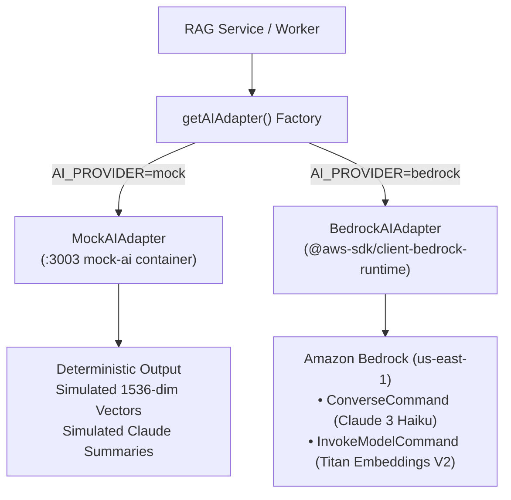
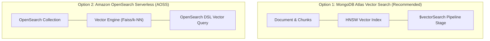
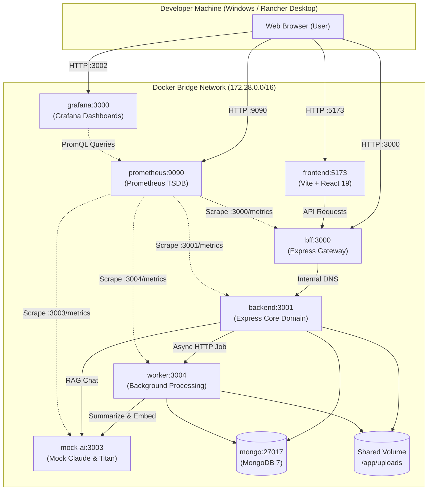
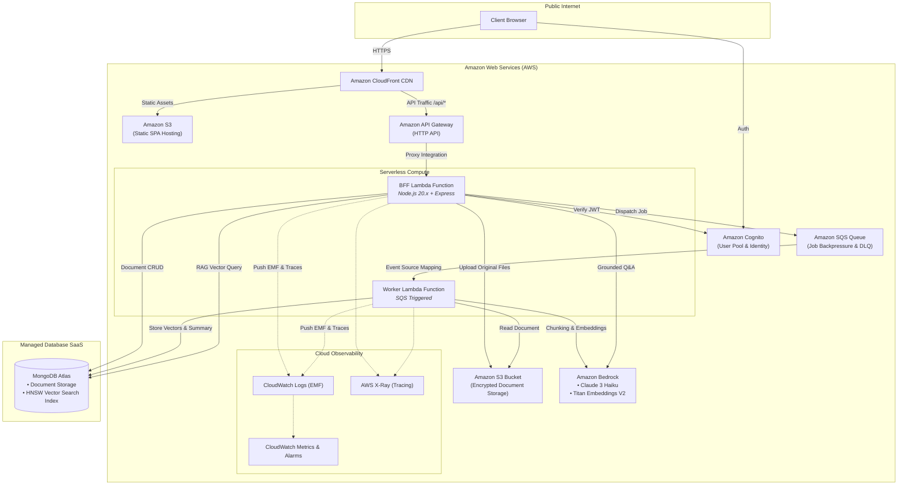
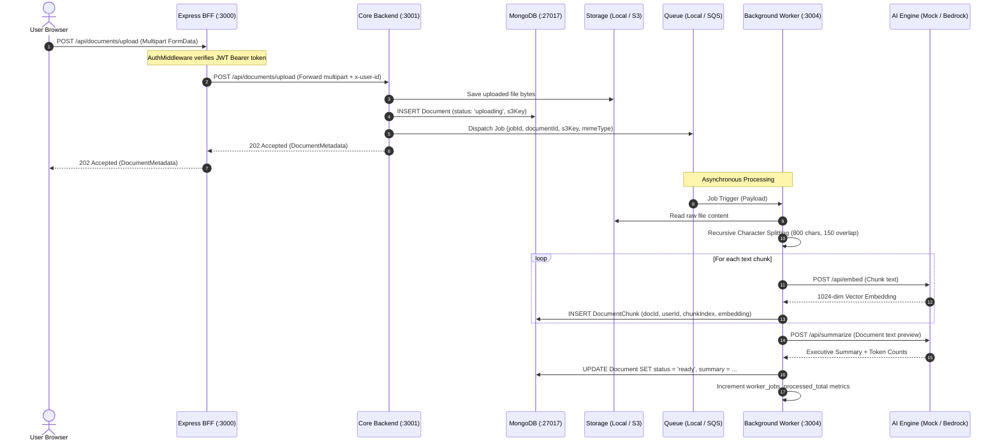
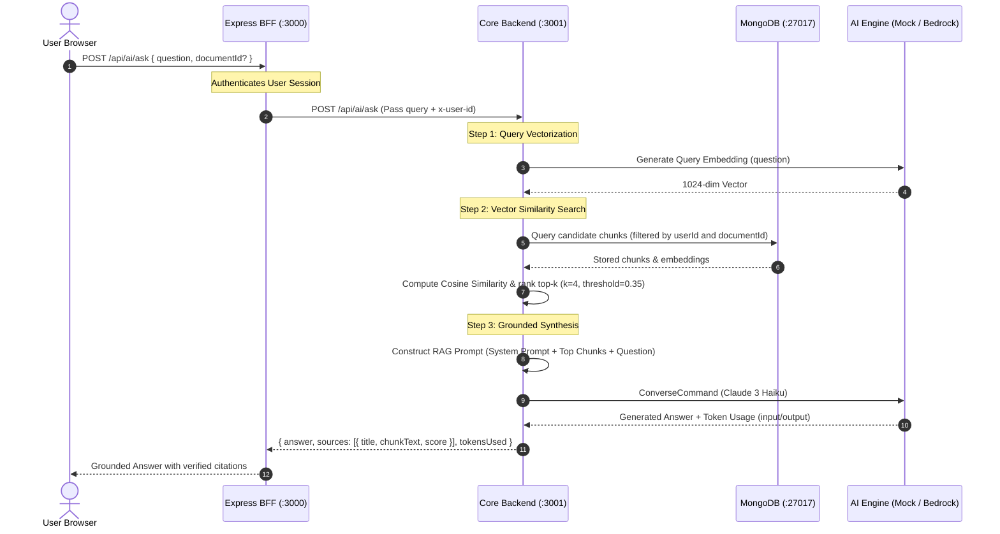
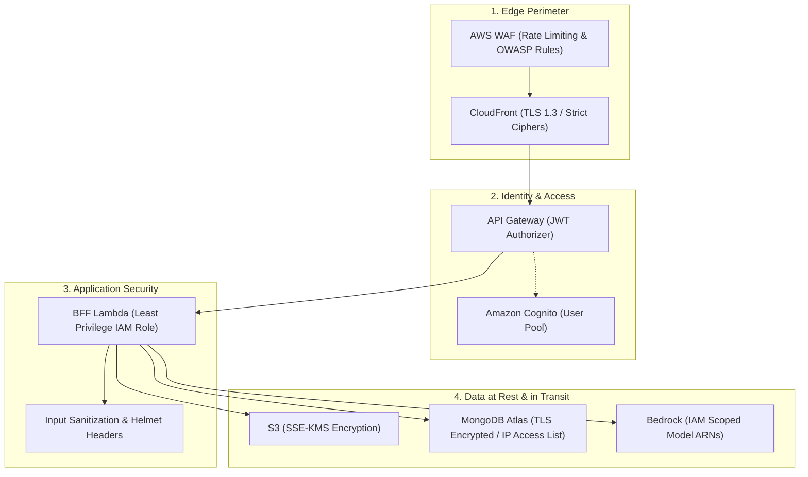

# DocuMind: Enterprise System Architecture & Cloud-Native Blueprint

## 1. Executive Summary

**DocuMind** is an enterprise AI-powered Knowledge Management and Document Assistant platform. It demonstrates how modern **MERN (MongoDB, Express, React, Node.js/TypeScript)** applications are architected, containerized, monitored, and scaled across both local development environments and production **Amazon Web Services (AWS)** infrastructure.

This document serves as the formal architectural reference and design rationale for software engineers, cloud architects, and technical mentors.

---

## 2. Core Architectural Decision Records (ADRs)

### ADR-001: The Backend-for-Frontend (BFF) Pattern

```mermaid
flowchart LR
    subgraph AntiPattern ["Traditional Anti-Pattern: Direct Microservice Access"]
        ClientA["Browser SPA"] -->|Direct Call| SvcA["Auth Service"]
        ClientA -->|Direct Call| SvcB["Document Service"]
        ClientA -->|Direct Call| SvcC["AI Service"]
    end

    subgraph BFFPattern ["DocuMind Architecture: Backend-for-Frontend"]
        ClientB["Browser SPA"] -->|HTTPS (Single Endpoint)| BFF["BFF Gateway Layer (:3000)"]
        BFF -->|Internal Network| AuthSvc["Auth Service (:3001)"]
        BFF -->|Internal Network| DocSvc["Document Service (:3001)"]
        BFF -->|Internal Network| AISvc["AI Service (:3001)"]
    end
```

#### Context & Problem Statement
In traditional Single-Page Applications (SPAs), the frontend browser often directly calls multiple distinct backend microservices. This introduces several architectural liabilities:
- **Chatty Network Egress**: The client must make multiple independent HTTP round-trips over public cellular/broadband networks.
- **Security Surface Exposure**: Internal service contracts, ports, IP addresses, and database structures are leaked to client network inspectors.
- **Coupling & Versioning Fragility**: Client updates are blocked whenever internal backend schemas or authentication handshakes evolve.

#### Decision
We introduce a dedicated **Backend-for-Frontend (BFF)** layer implemented in Node.js/Express (running on port `3000` locally, and packaged into an AWS Lambda function behind Amazon API Gateway in production).

#### Architectural Benefits
1. **Unified Security Boundary**: The frontend only knows the BFF. The BFF validates JWT tokens (Cognito in AWS), checks authorization scopes, sanitizes payloads, and attaches identity headers (`x-user-id`) before routing internally.
2. **Payload Aggregation & Shaping**: The BFF tailors data structures specifically for React UI views, omitting internal metadata (like MongoDB `__v` or internal S3 storage keys).
3. **Multipart Request Forwarding**: File uploads are buffered and streamed through the BFF to private backend storage, shielding core storage endpoints from direct public exposure.

---

### ADR-002: Express Inside Lambda vs. Single-Purpose Lambda Handlers

One of the most critical architectural decisions when migrating a Node.js/Express application to AWS serverless is choosing between:
1. **Monolithic Lambda (Express inside Lambda)** using adapters like `@codegenie/serverless-express`.
2. **Micro-Lambdas (Single-Purpose Handlers)** where each API Gateway route triggers a discrete Lambda function.

#### Comparative Analysis

| Evaluation Criteria | Approach A: Express Inside Lambda (Selected for BFF/Core) | Approach B: Single-Purpose Lambda Handlers |
| :--- | :--- | :--- |
| **Local / Cloud Parity** | **Highest**: The identical Express routing, middleware, and error handlers run locally in Docker and inside Lambda. | **Lower**: Requires emulating individual Lambda handler contexts or running heavy local emulators like LocalStack for every endpoint. |
| **Cold Start Impact** | Slightly larger bundle size (~15MB compressed), resulting in **~200–350ms** cold starts on initial container initialization. | Smallest bundle size (~2–5MB), producing faster **~100–150ms** cold starts. |
| **Infrastructure Complexity** | **Minimal**: A single API Gateway wildcard catch-all route (`ANY /{proxy+}`) routes traffic to a single Lambda function. | **High**: Dozens of API Gateway method/resource definitions, dozens of IAM roles, and multiple CDK construct configurations. |
| **Concurrency & Throttling** | All endpoints share the same Lambda concurrency pool. A spike in document search could throttle login requests. | Fine-grained reserved concurrency per endpoint. Critical endpoints (like `/login`) can be isolated. |
| **Deploy & Build Velocity** | Faster CI/CD: One build artifact to package, test, and deploy. | Slower CI/CD: Must package, tree-shake, and deploy 15+ individual Lambda zip archives. |

#### Architectural Resolution
DocuMind adopts a **Hybrid Serverless Architecture**:
- **BFF & Core REST APIs**: Deployed as **Express inside Lambda** using `@codegenie/serverless-express`. This preserves code reuse across Docker Compose and AWS, speeds up development velocity, and keeps routing logic unified in TypeScript.
- **Asynchronous Background Processing**: Deployed as an **Independent Single-Purpose Lambda** triggered directly by Amazon SQS. This completely isolates heavy document chunking, embeddings generation, and AI summarization from public HTTP latency and concurrency limits.

---

### ADR-003: Asynchronous Decoupling via Queue (Local Queue $\rightarrow$ Amazon SQS)

Document processing (parsing files, semantic chunking, vector embedding generation, and Claude summarization) takes between 2 to 15 seconds depending on file length.

#### Decision
The web client must never wait synchronously for AI indexing during file upload:
1. When a user uploads a document, the BFF routes to the Backend.
2. The Backend validates the file, stores raw bytes, creates a `Document` record in MongoDB with `status: 'uploading'`, and enqueues a job payload.
3. The API immediately returns an HTTP **`202 Accepted`** with the document metadata.
4. The background queue triggers the worker asynchronously.
5. The worker extracts text, chunks it, generates vector embeddings, summarizes the content, updates the database to `status: 'ready'`, and increments Prometheus metrics.
6. The React frontend auto-polls (or listens via WebSockets/SSE) until the status transitions to `ready`.

In local development, this queue is implemented via `LocalQueueAdapter` (asynchronous non-blocking HTTP dispatch). In AWS, this swaps transparently to **Amazon SQS** with an **AWS Lambda Event Source Mapping**.

---

### ADR-004: Dual-Mode AI Architecture (Local Mock vs. Amazon Bedrock)

#### Problem
Developers need to build, test, and verify application UI, data flows, and metrics completely offline without requiring active AWS credentials, incurring API charges, or waiting for cloud deployments.

#### Decision
We implement the **Adapter Pattern** with two concrete implementations of `IAIAdapter`:



- **`MockAIAdapter`**: Used in local Docker Compose. Returns realistic, deterministic responses with artificial latency and calculated token consumption.
- **`BedrockAIAdapter`**: Uses the official AWS SDK (`@aws-sdk/client-bedrock-runtime`). Uses the **Converse API** for Claude 3 Haiku and `InvokeModel` for Amazon Titan Text Embeddings V2.
- **Graceful Fallback**: If `AI_PROVIDER=bedrock` is specified but AWS credentials or regions are missing, the system logs a structured warning and safely falls back to local simulation without crashing the service.

---

### ADR-005: Vector Database Evaluation: MongoDB Atlas Vector Search vs. Amazon OpenSearch Serverless

To enable Retrieval-Augmented Generation (RAG), text chunks must be stored alongside their mathematical vector embeddings and queried via vector distance metrics.



#### Detailed Comparison

| Criterion | MongoDB Atlas Vector Search | Amazon OpenSearch Serverless (AOSS) | Local In-Memory / Cosine (Local Dev) |
| :--- | :--- | :--- | :--- |
| **MERN Alignment** | **Perfect**: Chunks, metadata, and vectors reside in the identical MongoDB collection (`document_chunks`). | **Disjoint**: Requires synchronizing MongoDB data to OpenSearch via DynamoDB Streams or EventBridge. | **Local**: Computes exact cosine similarity directly in the Node.js process over MongoDB candidate records. |
| **Indexing Algorithm** | Hierarchical Navigable Small World (**HNSW**) and Inverted File (**IVF**). | HNSW and Vector Engine for OpenSearch (Lucene & Faiss). | Exact linear scan ($O(N)$ brute-force) suitable for local dev datasets (< 5,000 chunks). |
| **Cost Profile** | **Free Tier Available**: Included in MongoDB Atlas Shared M0/M2/M5 tiers. M10 dedicated starts at ~\$57/mo. | **Costly for Dev/Learning**: Minimum billing is 2 Search OCUs + 2 Indexing OCUs = 4 OCUs $\approx$ **\$700/month**. | **\$0.00**: Completely free, runs locally in Docker container. |
| **Operational Overhead** | Zero infrastructure to manage; indexes created via JSON index definitions in Atlas console or CDK. | Must configure encryption policies, network security policies, collection access policies, and VPC endpoints. | None. |

#### Architectural Resolution
1. **Local Development (Phases 2–5)**: We implement **Exact Cosine Similarity vector search** directly against our local MongoDB `document_chunks` collection.
2. **AWS Production (Phase 6)**: We deploy against **MongoDB Atlas**, using native `$vectorSearch` pipeline stages for sub-15ms vector retrieval.

---

## 3. End-to-End System Diagrams

### 3.1 Local Development Cluster Architecture (Docker Compose)



---

### 3.2 Target AWS Cloud Serverless Architecture (Phases 6–9)



---

### 3.3 Complete Document Ingestion Sequence



---

### 3.4 Conversational RAG Query Sequence



---

## 4. Data Models & Vector Schema

DocuMind uses Mongoose schemas designed for seamless migration from local MongoDB to **MongoDB Atlas Vector Search**:

### 4.1 Document Metadata Collection (`documents`)
```typescript
interface IDocument {
  userId: string;              // Partition key for multi-tenant isolation
  title: string;               // Display title
  description?: string;        // User-provided description
  category: string;            // Business, Technical, Research, Legal, etc.
  tags: string[];              // Searchable taxonomy tags
  fileName: string;            // Original file basename
  fileSize: number;            // Size in bytes
  mimeType: string;            // text/markdown, application/pdf, etc.
  s3Key: string;               // Storage key in S3 or local volume
  status: 'uploading' | 'processing' | 'ready' | 'error';
  summary?: string;            // AI-generated executive summary
  createdAt: Date;
  updatedAt: Date;
}
```

### 4.2 Document Chunks Collection (`document_chunks`)
```typescript
interface IDocumentChunk {
  documentId: string;          // Foreign key reference to documents._id
  userId: string;              // Tenant boundary filter
  chunkIndex: number;          // Sequential order in source document
  text: string;                // Raw text slice (approx 800 chars)
  embedding: number[];         // 1024-dimensional normalized vector
  tokenCount: number;          // Ingestion token cost
  metadata: Record<string, unknown>; // Page number, section header, etc.
  createdAt: Date;
}
```

#### MongoDB Atlas Vector Search Index Definition
When deployed to MongoDB Atlas in Phase 6, the vector index is defined via Atlas JSON:
```json
{
  "mappings": {
    "dynamic": true,
    "fields": {
      "embedding": {
        "dimensions": 1024,
        "similarity": "cosine",
        "type": "knnVector"
      },
      "userId": {
        "type": "filter"
      },
      "documentId": {
        "type": "filter"
      }
    }
  }
}
```

---

## 5. Security & Identity Architecture

DocuMind enforces a **Defense-in-Depth** security posture across all tiers:



### 5.1 Least-Privilege IAM Policy for Bedrock
The Lambda execution role avoids broad `bedrock:*` permissions. It is explicitly restricted to only the exact Foundation Model ARNs used by DocuMind:
```json
{
  "Version": "2012-10-17",
  "Statement": [
    {
      "Sid": "DocuMindBedrockInvocation",
      "Effect": "Allow",
      "Action": [
        "bedrock:InvokeModel",
        "bedrock:Converse"
      ],
      "Resource": [
        "arn:aws:bedrock:us-east-1::foundation-model/anthropic.claude-3-haiku-20240307-v1:0",
        "arn:aws:bedrock:us-east-1::foundation-model/amazon.titan-embed-text-v2:0"
      ]
    }
  ]
}
```

---

## 6. Observability Framework: Local vs. Cloud

| Observability Pillar | Local Development (Docker Compose) | AWS Cloud Production (Target) |
| :--- | :--- | :--- |
| **Metrics Collection** | **Pull-based**: Prometheus polls `/metrics` HTTP endpoints on all containers every 5s. | **Push-based**: Lambda writes **CloudWatch Embedded Metric Format (EMF)** directly to `stdout`. |
| **Dashboards** | **Grafana (:3002)**: Auto-provisioned dashboards querying Prometheus via PromQL. | **CloudWatch Dashboards** or **Amazon Managed Grafana (AMG)** connected to CloudWatch/AMP. |
| **Alerting** | Prometheus Alertmanager evaluates `alert.rules.yml` thresholds every 5 seconds. | **CloudWatch Alarms** evaluating metric math, routing to **Amazon SNS** or PagerDuty. |
| **Distributed Tracing** | Synthetic correlation IDs passed via `x-correlation-id` headers. | **AWS X-Ray / OpenTelemetry (ADOT)** tracing from CloudFront $\rightarrow$ API Gateway $\rightarrow$ Lambda $\rightarrow$ Bedrock. |
| **Log Aggregation** | Docker stdout logs inspectable via `docker logs`. | **CloudWatch Logs Insights** with structured JSON log querying and retention policies. |

---

## 7. AWS Cost Economics & Sizing

DocuMind is engineered to maximize **AWS Free Tier** eligibility while delivering production-grade capabilities.

| Service | Free Tier / Low-Cost Allocation | Estimated Monthly Cost (Dev/Test) | Production Scale (100k requests/mo) |
| :--- | :--- | :--- | :--- |
| **Amazon CloudFront** | 1 TB data transfer out, 10M HTTP requests/mo | **\$0.00** | **\$0.00** (Within Free Tier) |
| **Amazon S3** | 5 GB standard storage, 20,000 GET, 2,000 PUT | **\$0.00** | ~\$0.25 |
| **AWS Lambda** | 1,000,000 free requests/mo, 3.2M seconds compute | **\$0.00** | **\$0.00** (Within Free Tier) |
| **Amazon API Gateway** | 1,000,000 HTTP API calls/mo free for 12 mos | **\$0.00** | ~\$0.10 |
| **Amazon Cognito** | 50,000 Monthly Active Users (MAUs) free | **\$0.00** | **\$0.00** (Within Free Tier) |
| **Amazon SQS** | 1,000,000 requests/mo free | **\$0.00** | **\$0.00** (Within Free Tier) |
| **Amazon Bedrock** | Pay-as-you-go per token (No standing hourly fee) | ~\$0.10 – \$0.50 (Testing) | ~\$2.50 – \$5.00 |
| **MongoDB Atlas** | M0 Free Tier (512MB storage) | **\$0.00** | ~\$9.00 (M2 Shared) / \$57 (M10 Dedicated) |
| **Total Estimated Cost** | — | **< \$1.00 / month** | **~\$12 – \$65 / month** |

---

## 8. Summary of Completed vs. Upcoming Phases

```
Phase 1: Architecture & Planning               [COMPLETED]
Phase 2: Local Development Foundation (Docker)  [COMPLETED]
Phase 3: Core Features & BFF Orchestration      [COMPLETED]
Phase 4: Observability, Metrics & Dashboards   [COMPLETED]
Phase 5: Amazon Bedrock & RAG Implementation    [COMPLETED]
──────────────────────────────────────────────────────────
Phase 6: AWS Cloud Deployment (CDK Infrastructure) [UPCOMING]
Phase 7: CloudWatch & AWS Observability        [UPCOMING]
Phase 8: GitHub Actions CI/CD with AWS OIDC    [UPCOMING]
Phase 9: Well-Architected Review & Hardening   [UPCOMING]
```
