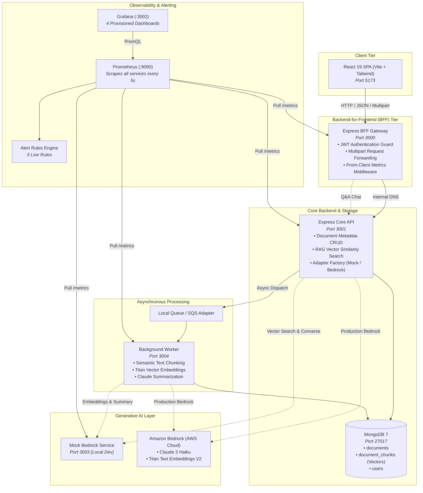

# DocuMind 🧠
> **Production-Style MERN Application on AWS with Docker, Serverless Architecture, Observability, and Amazon Bedrock**

[](https://nodejs.org)
[](https://www.typescriptlang.org/)
[](https://react.dev)
[](https://docs.docker.com/compose/)
[](https://aws.amazon.com/bedrock/)
[](https://prometheus.io/)
[](https://grafana.com/)
[](https://opensource.org/licenses/MIT)

DocuMind is an enterprise-grade AI-powered **Knowledge Management and Document Assistant** built with the **MERN stack** (MongoDB, Express, React, Node.js/TypeScript). Designed as a hands-on architectural journey, it evolves from a containerized local development cluster into an **AWS Serverless & Cloud-Native** infrastructure.

The platform enables users to ingest technical documents, organize and tag knowledge bases, perform high-dimensional **Retrieval-Augmented Generation (RAG)** vector searches, ask grounded questions with verified citations via **Amazon Bedrock (Claude 3 Haiku & Titan Text Embeddings)**, and observe complete system telemetries in real time via **Prometheus and Grafana**.

---

## 📑 Table of Contents

- [Architectural Overview](#-architectural-overview)
- [Monorepo Package Structure](#-monorepo-package-structure)
- [Local Quick Start](#-local-quick-start)
- [Service Registry & Port Mapping](#-service-registry--port-mapping)
- [AI Engine: Local Mock vs. Live Amazon Bedrock](#-ai-engine-local-mock-vs-live-amazon-bedrock)
- [Observability: Prometheus & Grafana](#-observability-prometheus--grafana)
- [Synthetic Load Testing](#-synthetic-load-testing)
- [Phased Project Roadmap](#-phased-project-roadmap)
- [Deep Dive Architecture Document](#-deep-dive-architecture-document)

---

## 🏛 Architectural Overview



### Key Architectural Patterns
- **Backend-for-Frontend (BFF)**: The React client only communicates with the BFF gateway (`:3000`). The BFF handles cookie/JWT sessions, aggregates data, and proxies to internal services, isolating private APIs from the public browser.
- **Retrieval-Augmented Generation (RAG)**: Documents are chunked using recursive character splitting (800 chars, 150 overlap), embedded into 1024-dimensional vectors, and stored in MongoDB. User questions execute vector similarity search before invoking Claude 3 Haiku for grounded, hallucination-free answers.
- **Asynchronous Decoupling**: File upload and ingestion return an immediate `202 Accepted`. Heavy parsing, chunking, embedding, and summarization run asynchronously via a background worker queue.
- **Dual-Mode AI Engine**: Local development runs completely offline with high-fidelity simulation (`mock-ai`). Switching to live AWS Bedrock requires only setting `AI_PROVIDER=bedrock`.

---

## 📦 Monorepo Package Structure

```
AWS-Demo/
├── packages/
│   ├── frontend/         # React 19 + TypeScript + Vite + Tailwind CSS + Zustand
│   ├── bff/              # Express Backend-for-Frontend Gateway & Auth Middleware
│   ├── backend/          # Express Core Backend, Mongoose Models, RAG Service
│   ├── worker/           # Background Document Processing & Embedding Pipeline
│   ├── mock-ai/          # Local simulation of Bedrock Claude 3 Haiku & Titan
│   └── shared/           # Common TypeScript interfaces, types, and validators
├── monitoring/
│   ├── prometheus/       # Prometheus scrape configuration & alert.rules.yml
│   └── grafana/          # Auto-provisioned Grafana datasources & 4 dashboards
├── scripts/
│   └── simulate-load.ts  # End-to-end multi-user synthetic traffic generator
├── docker-compose.yml    # Complete 8-container local development cluster
├── package.json          # Root workspace configuration (pnpm v12)
├── ARCHITECTURE.md       # In-depth architectural blueprint and AWS design
└── README.md             # Project documentation
```

---

## 🚀 Local Quick Start

### Prerequisites
- [Node.js](https://nodejs.org/) `>= 20.0.0`
- [pnpm](https://pnpm.io/) `>= 9.0.0` (`npm install -g pnpm`)
- [Rancher Desktop](https://rancherdesktop.io/) or Docker Desktop with **Docker Engine (`dockerd`)** enabled.

### 1. Clone & Install Dependencies
```bash
git clone https://github.com/vikartp/AWS-Demo.git
cd AWS-Demo
pnpm install
```

### 2. Start the Local Docker Cluster
Start all 8 containers with one command:
```bash
docker-compose up --build -d
```

Verify that all services are healthy:
```bash
docker ps
```

### 3. Open the Application
- **Web Application**: [http://localhost:5173](http://localhost:5173)
  - Register a new account or log in with test credentials.
  - Upload PDF, Markdown, or Text documents.
  - Open the **AI Assistant** tab ([http://localhost:5173/chat](http://localhost:5173/chat)) to ask context-aware questions.
- **Grafana Dashboards**: [http://localhost:3002](http://localhost:3002) (Login: `admin` / `documind`)
- **Prometheus Alerts & Metrics**: [http://localhost:9090](http://localhost:9090)

---

## 🌐 Service Registry & Port Mapping

| Service | Port | Internal Docker URL | Purpose |
| :--- | :--- | :--- | :--- |
| **Frontend** | `5173` | `http://frontend:5173` | Single-Page Application (React 19, Tailwind) |
| **BFF Gateway** | `3000` | `http://bff:3000` | Public API Gateway, JWT verification, proxying |
| **Core Backend** | `3001` | `http://backend:3001` | Internal document domain, RAG search, MongoDB operations |
| **Grafana** | `3002` | `http://grafana:3000` | Pre-configured metrics visualization dashboards |
| **Mock AI** | `3003` | `http://mock-ai:3003` | Local offline simulation of Claude 3 Haiku & Titan |
| **Worker** | `3004` | `http://worker:3004` | Async document parsing, chunking, and vector embedding |
| **Prometheus** | `9090` | `http://prometheus:9090` | Time-series metrics collection & alert evaluation |
| **MongoDB** | `27017`| `mongodb://mongo:27017`| Application database and vector storage |

---

## 🤖 AI Engine: Local Mock vs. Live Amazon Bedrock

DocuMind uses the **Adapter Design Pattern** to make switching between local development and AWS Bedrock completely seamless.

### Mode 1: Local Development (Default)
Runs 100% offline with zero AWS credentials. The `packages/mock-ai` service simulates:
- **`POST /api/summarize`**: Simulates Claude 3 Haiku executive summarization.
- **`POST /api/embed`**: Simulates Amazon Titan Embeddings (deterministic normalized vector output).
- **`POST /api/chat`**: Simulates Claude 3 Haiku Converse API with context grounding.

### Mode 2: Live Amazon Bedrock
To use real AWS Bedrock foundation models:
1. Enable model access for **Claude 3 Haiku** and **Amazon Titan Text Embeddings V2** in the [Amazon Bedrock Console](https://console.aws.amazon.com/bedrock/).
2. Set the environment variables in `.env` or `docker-compose.yml`:
   ```env
   AI_PROVIDER=bedrock
   AWS_REGION=us-east-1
   AWS_ACCESS_KEY_ID=AKIA...
   AWS_SECRET_ACCESS_KEY=...
   BEDROCK_CHAT_MODEL_ID=anthropic.claude-3-haiku-20240307-v1:0
   BEDROCK_EMBED_MODEL_ID=amazon.titan-embed-text-v2:0
   ```
3. Restart containers: `docker-compose up -d backend worker`

---

## 📊 Observability: Prometheus & Grafana

All services are instrumented with **`prom-client`** and scraped by Prometheus every **5 seconds**.

### Grafana Dashboards (Auto-Provisioned)
Log in to [http://localhost:3002](http://localhost:3002) (`admin` / `documind`):
1. **DocuMind - Application Overview**: Real-time traffic throughput, active connections, error rate %, AI token burn rate.
2. **DocuMind - API Performance & Latency**: RED method breakdown (Rate, Errors, Duration), P50/P90/P99 latency percentiles.
3. **DocuMind - Amazon Bedrock & AI Usage**: Model invocation frequencies, input/output token counts, estimated AWS Bedrock cost calculations.
4. **DocuMind - Async Worker & Queue Processing**: Ingestion throughput, job duration histograms, upload size distributions.

### Alert Rules (`alert.rules.yml`)
View live evaluation at [http://localhost:9090/alerts](http://localhost:9090/alerts):
- **`ServiceDown`**: Triggers if any container target drops offline for > 30 seconds.
- **`HighHttpErrorRate`**: Triggers if 5xx errors exceed 5% of traffic over a 2-minute window.
- **`HighBffLatency`**: Triggers if P90 user latency exceeds 1.5s for 2 minutes.
- **`WorkerJobFailures`**: Triggers if background document processing fails.
- **`HighAiLatency`**: Triggers if AI model execution exceeds 3.0 seconds.

---

## ⚡ Synthetic Load Testing

DocuMind includes an automated traffic generator script to populate Prometheus metrics and test cluster performance under load:

```bash
pnpm simulate:load
```

**What the load test simulates**:
1. Creates and authenticates 3 distinct user sessions (`architect`, `devops`, `security`).
2. Concurrently uploads 4 multi-page enterprise markdown/technical guides.
3. Fires 30 randomized search and tag query operations.
4. Triggers intentional edge-case error scenarios (400 Bad Request, 401 Unauthorized, 404 Not Found) to exercise error dashboards.
5. Invokes 5 conversational AI Bedrock questions and records token consumption.

---

## 🗺 Phased Project Roadmap

| Phase | Milestone | Status | Key Deliverables |
| :---: | :--- | :---: | :--- |
| **Phase 1** | **Architecture & Planning** | ✅ Complete | Monorepo scaffold, tech stack selection, architecture blueprint. |
| **Phase 2** | **Local Development Foundation** | ✅ Complete | Docker Compose, Rancher Desktop, MongoDB, Prometheus, Grafana. |
| **Phase 3** | **Application Features & BFF** | ✅ Complete | JWT Authentication, Document CRUD, BFF orchestration, React UI. |
| **Phase 4** | **Observability Stack** | ✅ Complete | Custom metrics, 4 Grafana dashboards, 5 alert rules, load simulator. |
| **Phase 5** | **AI Integration & Bedrock** | ✅ Complete | RAG pipeline, semantic chunking, Claude 3 Haiku Converse, Titan Embeddings. |
| **Phase 6** | **AWS Cloud Deployment (CDK)** | 🔄 Upcoming | API Gateway, Lambda, Cognito, S3, CloudFront, MongoDB Atlas. |
| **Phase 7** | **AWS Observability** | 🔄 Upcoming | CloudWatch Logs Insights, X-Ray distributed tracing, AMP/AMG. |
| **Phase 8** | **CI/CD Automation** | 🔄 Upcoming | GitHub Actions pipeline with secure AWS OIDC role assumption. |
| **Phase 9** | **Production Readiness** | 🔄 Upcoming | Well-Architected review, security hardening, cost alarms. |

---

## 📖 Deep Dive Architecture Document

For a comprehensive explanation of architectural trade-offs, vector database evaluations, Express-in-Lambda vs. single handlers, and AWS serverless migration plans, read:
👉 **[ARCHITECTURE.md](./ARCHITECTURE.md)**

---

## 📜 License

This project is licensed under the MIT License - see the [LICENSE](LICENSE) file for details.
